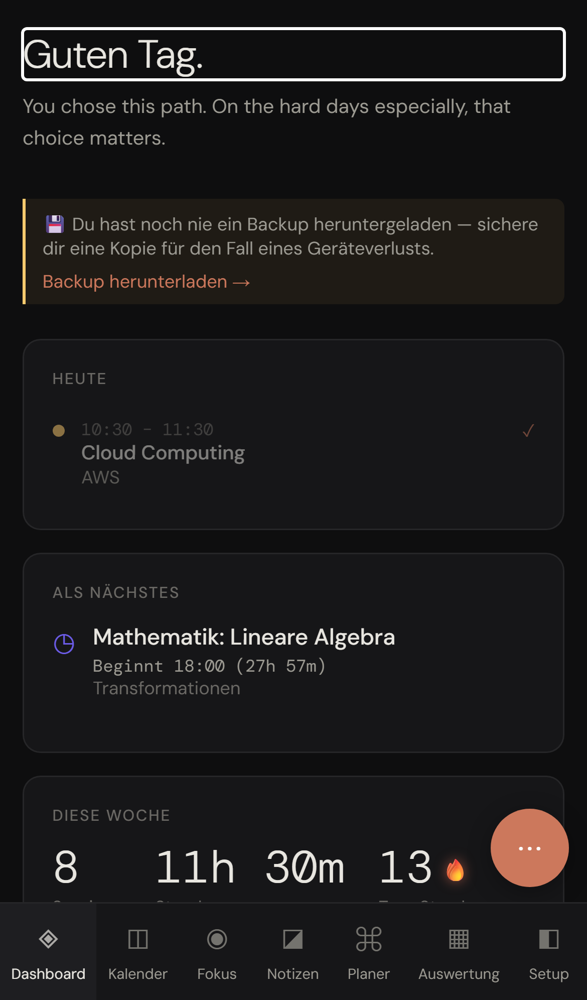

# StudyLife App (iOS / Android / Mac / Windows)

[](https://github.com/lukislp/studylife-app/actions/workflows/ci-cd.yml) [](https://scorecard.dev/viewer/?uri=github.com/lukislp/studylife-app) [](https://github.com/lukislp/studylife-app/security/code-scanning)
[](https://github.com/lukislp/studylife-app/releases)
[](LICENSE)
[](https://dotnet.microsoft.com/apps/maui)

Native app shell for [StudyLife](https://github.com/lukislp/studylife) built on **.NET MAUI Blazor Hybrid**.
The entire frontend (Razor components, CSS, JS interop, all 26 languages) comes **directly
from the studylife repo via a project reference** — no copy, so the app UI is always
automatically identical to the web/PWA UI. The app talks to the same REST API as the
browser client.

https://github.com/user-attachments/assets/53ada52d-7724-4734-8135-cc72395e1a1c

```
repos/
├── studylife/                  github.com/lukislp/studylife (Server, Client, Shared)
└── studylife-app/               this repo (github.com/lukislp/studylife-app)
    └── src/StudyLife.App/      MAUI Blazor Hybrid (references ../../studylife/src/StudyLife.Client)
```

**Important:** Both repos must be checked out side by side, in the same parent directory,
each under its own repo name (`studylife` and `studylife-app`) — the project reference is
relative.



*Captured from the live demo in a phone-sized viewport — this app's native shell renders the
exact same `StudyLife.Client` UI shown here, project-referenced rather than copied (see above).*

## What the app can do beyond the iOS PWA

| Feature | PWA (iOS) | Native App |
|---|---|---|
| Home screen quick actions ("Start Focus", "New Note", "Calendar") | ✗ (manifest shortcuts are ignored) | ✓ (long-press the icon, iOS + Android) |
| Timer/session notifications | only with the PWA installed + Web Push | ✓ native local notifications (even in the foreground) |
| App icon badge | limited | ✓ (iOS/Mac) |
| Screen stays on during focus timer (wake lock) | ✗ in WKWebView | ✓ native (`KeepScreenOn`) |
| Passkey login | ✓ (Safari) | ✓ via system browser sheet (see below) |
| Lock screen / Dynamic Island focus timer (Live Activity) | ✗ | ✓ (iOS; local updates on any tier, remote push updates while the app is fully closed need paid signing - see below) |
| Siri/Shortcuts "Open Focus" | ✗ | ✓ (iOS, navigates straight to the focus page) |
| Home screen widget (today's study time, streak) | ✗ | ✓ (iOS/Android) |
| Share sheet → new note | ✗ | ✓ (share any text from another app directly into a StudyLife note) |
| Study readiness score + sleep consistency (Dashboard) | ✗ | ✓ (iOS, via Apple HealthKit - Heart Rate Variability + Sleep Analysis, read-only, on-device only) |
| Movement-break reminder (Focus Timer) | ✗ | ✓ (iOS, via Apple HealthKit step count, read-only) |
| Cardio fitness (VO2max) trend (Evaluation) | ✗ | ✓ (iOS, via Apple HealthKit, read-only - populated from Apple Watch outdoor walk/run workouts) |

## First launch

On first launch, the app asks for the **server URL** (e.g. `https://studylife.example.com`)
and validates it via a `manifest.json` request. The URL is stored in the native app
preferences. To change it: clear app data (iOS: reinstall the app, Android: "Clear
storage") and restart.

## Passkey login (how it works)

WebAuthn doesn't exist in native WebViews (WKWebView/Android WebView). The app therefore
opens the server's **actual** login page in a system browser sheet when logging
in/registering/linking a device (iOS: `ASWebAuthenticationSession`, Android: Custom
Tabs) — passkeys work fully there (Face ID, iCloud Keychain, Google Password Manager).
After completion, the page hands the session token back to the app via a
`studylife://auth?token=…` redirect (client-side, gated on `?app=1` — no server-side
special path, the normal web flow is untouched).

No associated-domains entitlement needed ⇒ **works with a free Apple account**.

Known limitation: "Add an additional passkey on THIS device" from Settings
(register/begin-additional) needs WebAuthn in the WebView and doesn't work in the app —
use the device-link flow (`/link`) instead, which works fully. Releasing/managing
passkeys in Settings works normally (plain HTTP).

## Installing on Android

Every [release](https://github.com/lukislp/studylife-app/releases/latest) attaches
`StudyLife-android.apk`, signed with the project's release key. Its versionName is the
release version and its versionCode is derived from it (see
[Release signing](#android-release-signing-maintainers)), so each newer release installs as
an update over the previous one and keeps the app's data.

1. Download `StudyLife-android.apk` from the latest release.
2. Optionally verify it (next section).
3. Open it on the phone and allow installing from this source when Android asks.

To update, install the APK of a newer release the same way.

> **One-time step for builds up to v1.8.28.** Those releases were debug-signed with a key
> that changed on every build and all had versionCode 1, so Android refuses to update them
> ("App not installed"). Uninstall that build once, then install the current release.
> Uninstalling deletes the app's local data on the phone (server address, sign-in, local
> settings); everything stored on your StudyLife server stays. From then on every update
> installs in place.

### Verifying the download

Each asset has a keyless Sigstore signature bundle (`<asset>.sigstore.json`) and the release
carries a build provenance attestation (`provenance.intoto.jsonl`), both minted by this
repository's release workflow on `main`. A notarized `StudyLife-macos.zip` (see "Apple release
signing" below) is signed by the TestFlight workflow instead and has its own
`StudyLife-macos.zip.intoto.jsonl`; the regular expression below accepts both workflows:

```bash
gh release download --repo lukislp/studylife-app --pattern 'StudyLife-android.apk*'
cosign verify-blob --bundle StudyLife-android.apk.sigstore.json \
  --certificate-identity-regexp '^https://github.com/lukislp/studylife-app/\.github/workflows/(ci-cd|apple-testflight)\.yml@refs/heads/main$' \
  --certificate-oidc-issuer https://token.actions.githubusercontent.com StudyLife-android.apk
gh attestation verify StudyLife-android.apk --repo lukislp/studylife-app
sha256sum StudyLife-android.apk
```

The release run's job summary ("Android APK (release)") lists the APK's SHA-256 and the
SHA-256 fingerprint of the signing certificate. The certificate is the same for every
release; check it with either of:

```bash
apksigner verify --print-certs StudyLife-android.apk   # Android SDK build-tools
keytool -printcert -jarfile StudyLife-android.apk      # any JDK
```

A different fingerprint than the previous release means the APK was not signed with the
project's key - do not install it.

## Building

Prerequisite: .NET 10 SDK + MAUI workloads (`dotnet workload restore` in the project
folder).

### Android (directly on Windows)

```powershell
cd src/StudyLife.App
dotnet publish -f net10.0-android -c Release
# APK: bin/Release/net10.0-android/publish/app.studylife.mobile-Signed.apk
```

A local build is signed with your machine's Android debug key: fine for sideloading onto your
own device, but it cannot update a release install (and a release cannot update it), because
Android only accepts an update signed with the same certificate.

### Android release signing (maintainers)

Pull requests build and sign a test APK with a throwaway key generated on the runner
(artifact `android-test-apk`), which exercises the release path without any secret. Releases
are built by the `release-android` job of `.github/workflows/ci-cd.yml` with
`scripts/build-android-apk.sh` after semantic-release has determined the version:

- versionName = the release version, e.g. `1.8.29`
- versionCode = `major * 10000 + minor * 100 + patch` (1.8.29 -> 10829). Monotonic while minor
  and patch stay below 100; the script rejects anything else instead of producing a lower
  code. Android's limit (2100000000) leaves room up to major 209999. Builds up to v1.8.28 all
  had versionCode 1.

The job reads four repository secrets and fails - and with it the whole release - when one of
the first three is missing; a debug-signed APK is never published:

| Secret | Content |
| --- | --- |
| `ANDROID_KEYSTORE_BASE64` | the keystore file, base64 encoded |
| `ANDROID_KEYSTORE_PASSWORD` | keystore password |
| `ANDROID_KEY_ALIAS` | alias of the key inside the keystore |
| `ANDROID_KEY_PASSWORD` | optional, key password; defaults to the keystore password |

Creating the key once (any JDK's `keytool`; PKCS12 keystores use the store password for the
key as well, so `ANDROID_KEY_PASSWORD` stays unset):

```bash
keytool -genkeypair -v -keystore studylife-release.jks -storetype PKCS12 \
  -alias studylife -keyalg RSA -keysize 4096 -validity 10000 \
  -dname "CN=StudyLife"
keytool -list -v -keystore studylife-release.jks -alias studylife | grep SHA256   # fingerprint

base64 -w0 studylife-release.jks | gh secret set ANDROID_KEYSTORE_BASE64 --repo lukislp/studylife-app
gh secret set ANDROID_KEYSTORE_PASSWORD --repo lukislp/studylife-app   # prompts for the value
gh secret set ANDROID_KEY_ALIAS --repo lukislp/studylife-app --body studylife
```

Keep the keystore file and its password backed up outside GitHub (a secret cannot be read
back). Losing the key means no release can ever update existing installs again - every user
would have to uninstall once more. `-validity 10000` (about 27 years) keeps the certificate
valid for the app's lifetime.

The job summary of each release run lists the signer certificate's SHA-256; it must match the
fingerprint printed above.

### iOS — the production path (own signing pipeline on the Mac)

> **Why not Sideloadly?** Its signer doesn't set the `CS_EXECSEG_MAIN_BINARY` flag on
> app extensions — AMFI then kills the Live Activity extension immediately ("has
> entitlements but is not a main binary", verified via the kernel log). The custom
> pipeline uses Apple's original `codesign` + `devicectl` and doesn't have this problem.

**One-time setup** (Mac with Xcode + .NET 10 SDK + `dotnet workload restore`):
1. Add the Apple ID in Xcode (Xcode → Settings → Accounts) — a free account works too.
2. Connect the iPhone once via USB to the Mac ("Trust"), enable Developer Mode on the
   iPhone.
3. `bash scripts/provision.sh` — creates a headless certificate + profiles (App and
   widget extension, via the xcodegen project in `native/ios-signing`) and registers the
   device.
4. Store the Mac login password for headless keychain access (stays local):
   `printf '%s' 'PASSWORD' > ~/.studylife-sign-pass && chmod 600 ~/.studylife-sign-pass`

**Building + installing** (from then on at any time, even entirely via SSH from the PC):
```bash
bash scripts/build-ios-ipa.sh      # .NET publish + swiftc bridge + Xcode widget extension
bash scripts/sign-and-install.sh   # Apple codesign (inside-out) + devicectl install (USB/Wi-Fi)
```
**7-day rule (free account):** simply run `sign-and-install.sh` again — or use the
launchd auto-renewal job (see `scripts/install-renewal-agent.sh`), so it happens by
itself over Wi-Fi and the signature never expires. Data/login is always preserved.

**Paid developer account:** normal signing/TestFlight/App Store. Two features detect the
paid entitlement themselves at runtime (`AppleSigningInfo`) — free-signed builds
automatically fall back, no switch to forget and no separate code paths to maintain:

- **Live Activity remote push** (lock screen countdown keeps updating through phase
  changes even while the app is fully terminated, via APNs) activates automatically once
  built with a paid, push-capable provisioning profile (`AppleSigningInfo.HasPushEntitlement`)
  or installed from TestFlight/the App Store (Apple strips `embedded.mobileprovision` there;
  those builds are always signed with `aps-environment`, `scripts/apple/entitlements/ios-app.plist`)
  and the server has an APNs key configured (`Apns__*`, see the main app repo's
  [`docs/ARCHITECTURE.md`](https://github.com/lukislp/studylife/blob/main/docs/ARCHITECTURE.md)). Live Activities themselves (the lock screen card while the
  app is open/backgrounded) work on **any** signing tier — only the remote-push keep-alive
  needs paid signing.
- **Native in-app passkey dialog** (Face ID directly in the app, without a browser sheet)
  is implemented (`AppleInAppPasskeys`, gated on `AppleSigningInfo.HasAssociatedDomains`)
  but **deliberately hardcoded off** (`NativeAppAuth.SupportsInAppPasskeys => false`)
  regardless of signing tier: since iOS 14, `swcd` only ever loads the
  `apple-app-site-association` file via Apple's own CDN, which in turn needs the domain
  to be crawlable from the public internet — this server is deliberately internal-only, so
  the CDN can never verify it and the native dialog fails deterministically
  (`ASAuthorizationError code=1004`). The system-browser flow (`AuthenticateAsync`) stays
  the only passkey path unless the server ever becomes publicly reachable, at which point
  flipping `SupportsInAppPasskeys` back to `AppleSigningInfo.HasAssociatedDomains` is the
  only change needed.

### Mac (Catalyst) / Windows

```bash
dotnet build -f net10.0-maccatalyst -c Release    # on the Mac
dotnet build -f net10.0-windows10.0.19041.0       # on Windows (dev/test target)
```

### Apple release signing (maintainers)

Releases never wait for Apple signing or for an approval: every push to `main` with a
release publishes the tag, the GitHub release, the Android APK, the Windows ZIP and an ad-hoc
signed `StudyLife-macos.zip` (job `release-macos`, no Apple secret). The iPhone app (with its
Apple Watch app) and the Mac app go to **TestFlight** (internal testers only, no Beta App
Review) only when the owner starts the separate workflow **Apple TestFlight**
(`.github/workflows/apple-testflight.yml`) for a release of his choice - releases can be
skipped and shipped together later. The local Mac pipeline above (direct device installs) is
unchanged.

| Job | Workflow, trigger | What it does |
| --- | --- | --- |
| `test-ios` | `ci-cd.yml`, every PR and push | builds the full iOS bundle (`scripts/apple/release-ios.sh`) and signs it ad hoc |
| `test-maccatalyst` | `ci-cd.yml`, every PR and push | builds the Mac app, signs both variants ad hoc with their real entitlements, launch-checks them (`scripts/apple/release-maccatalyst.sh`) |
| `release-macos` | `ci-cd.yml`, push to `main` with a release | the same build with the release version, ad hoc signed (hardened runtime): `StudyLife-macos.zip` for the GitHub release |
| `resolve` | `apple-testflight.yml`, manual | checks the chosen tag (form `vX.Y.Z`, has a GitHub release, its commit is on `main`) and resolves it to that commit |
| `testflight-ios` | `apple-testflight.yml`, manual, approval | App Store signature, upload of `StudyLife-ios.ipa` to TestFlight |
| `testflight-macos` | `apple-testflight.yml`, manual, approval | App Sandbox + Mac App Store profile + installer signature, upload of `StudyLife-macos.pkg` to TestFlight; with the Developer ID secrets also a notarized `StudyLife-macos.zip` |
| `publish-notarized-zip` | `apple-testflight.yml`, after `testflight-macos` | only with a notarized ZIP: signs it (Sigstore), attests its provenance and replaces the release's ad-hoc signed ZIP |

**Shipping a TestFlight build.** Actions -> "Apple TestFlight" -> "Run workflow" (branch
`main`) -> enter the release tag, e.g. `v1.8.30`, or leave it empty for the latest release ->
"Run workflow". Then approve the two deployments of the environment `release` in the run
("Review deployments" -> select both -> "Approve and deploy"). The jobs check out exactly the
tagged commit (the sibling `lukislp/studylife` checkout is its current `main`, as in the
release run) and use no caches. After Apple's processing (usually minutes, sometimes an hour)
the builds show up in App Store Connect -> TestFlight.

The TestFlight jobs use the GitHub Environment **`release`** (required reviewer: the owner,
deployment branches: `main` only). Its secrets never reach pull requests or other jobs, and
nothing runs with them before the owner approves. A missing TestFlight secret fails that job;
nothing unsigned is uploaded.

**The Mac release ZIP.** Every release carries the ad-hoc signed `StudyLife-macos.zip`
(Gatekeeper asks once: right-click "Open", or `xattr -cr`). If the optional Developer ID
secrets are set, a TestFlight run also builds a Developer ID signed, notarized and stapled ZIP,
and `publish-notarized-zip` uploads it over the ZIP of that release together with a new
`StudyLife-macos.zip.sigstore.json` (signer: `apple-testflight.yml` on `main`) and
`StudyLife-macos.zip.intoto.jsonl` (its build provenance). The release's
`provenance.intoto.jsonl` still lists the digest of the replaced ad-hoc ZIP; it stays valid for
the other assets, and `gh attestation verify StudyLife-macos.zip --repo lukislp/studylife-app`
finds the new attestation. Without the Developer ID secrets the run leaves the release
untouched (notice in the run).

Versions: `CFBundleShortVersionString` is the release version, `CFBundleVersion` uses the
Android versionCode formula (`major * 10000 + minor * 100 + patch`, 1.8.30 -> 10830), set on
the app and on every embedded bundle (App Store Connect rejects mismatches). Every release
therefore has a new, higher build number. `ITSAppUsesNonExemptEncryption` is `false` (the
app only uses system TLS and hashing), so builds need no export-compliance answer.

**Bundle identifiers and capabilities** (Certificates, Identifiers & Profiles -> Identifiers;
the App Group is `group.app.studylife.mobile`):

| Bundle ID | Bundle | Capabilities |
| --- | --- | --- |
| `app.studylife.mobile` | iOS app, also the Mac Catalyst app (same ID, one App Store Connect record with iOS and macOS) | App Groups, Push Notifications, HealthKit |
| `app.studylife.mobile.widgets` | widgets / Live Activity extension | App Groups |
| `app.studylife.mobile.share` | share extension | App Groups |
| `app.studylife.mobile.watchkitapp` | Apple Watch app | App Groups |
| `app.studylife.mobile.watchkitapp.widgets` | watch complications | App Groups |

Associated Domains is not needed: the in-app passkey dialog is switched off (see "Paid
developer account" above), so release builds do not carry that entitlement. The entitlements
each bundle is signed with are in `scripts/apple/entitlements/` and
`src/StudyLife.App/Platforms/MacCatalyst/Entitlements.plist`; `scripts/apple/signing.py`
adds the identity keys from the profile and fails with the missing capability's name if a
profile does not grant a declared entitlement.

**Certificates and profiles:**

| Item | Used for | Valid |
| --- | --- | --- |
| Apple Distribution certificate | iOS app + bundles, Mac TestFlight app | 1 year |
| Mac Installer Distribution certificate (common name "3rd Party Mac Developer Installer") | the TestFlight `.pkg` | 1 year |
| Developer ID Application certificate (optional) | notarized `StudyLife-macos.zip` | 5 years |
| App Store profiles (iOS) for the five bundle IDs above | iOS | 1 year, or until the certificate is revoked |
| Mac Catalyst App Store profile for `app.studylife.mobile` | Mac TestFlight | 1 year |
| App Store Connect API key, role **Developer** (team key) | TestFlight upload (`altool`) and notarization (`notarytool`) | until revoked |

Export each certificate with its private key as `.p12`. macOS only imports the legacy
encryption: from OpenSSL 3 use `openssl pkcs12 -export -legacy ...` (Keychain Access exports
are fine). `scripts/apple/keychain.sh` imports them into a temporary keychain together with
Apple's intermediate certificates (downloaded, SHA-256 pinned) and deletes the keychain and
every decoded file at the end of the job.

**Secrets of the `release` environment** (all base64 values are single-line base64 of the
file):

| Secret | Content | Needed by |
| --- | --- | --- |
| `APPLE_TEAM_ID` | 10-character team ID | both |
| `APPLE_DISTRIBUTION_P12_BASE64` / `APPLE_DISTRIBUTION_P12_PASSWORD` | Apple Distribution `.p12` and its password | both |
| `APPLE_MAC_INSTALLER_P12_BASE64` / `APPLE_MAC_INSTALLER_P12_PASSWORD` | Mac Installer Distribution `.p12` | `testflight-macos` |
| `APPLE_DEVELOPER_ID_P12_BASE64` / `APPLE_DEVELOPER_ID_P12_PASSWORD` | Developer ID Application `.p12` (optional, both or neither) | `testflight-macos` |
| `APPLE_PROFILE_IOS_BASE64` | profile for `app.studylife.mobile` (iOS App Store) | `testflight-ios` |
| `APPLE_PROFILE_IOS_WIDGETS_BASE64` | profile for `app.studylife.mobile.widgets` | `testflight-ios` |
| `APPLE_PROFILE_IOS_SHARE_BASE64` | profile for `app.studylife.mobile.share` | `testflight-ios` |
| `APPLE_PROFILE_WATCH_BASE64` | profile for `app.studylife.mobile.watchkitapp` | `testflight-ios` |
| `APPLE_PROFILE_WATCH_WIDGETS_BASE64` | profile for `app.studylife.mobile.watchkitapp.widgets` | `testflight-ios` |
| `APPLE_PROFILE_MAC_BASE64` | Mac Catalyst App Store profile for `app.studylife.mobile` | `testflight-macos` |
| `ASC_API_KEY_P8_BASE64` | App Store Connect API key (`AuthKey_<id>.p8`) | both |
| `ASC_API_KEY_ID` / `ASC_API_ISSUER_ID` | key ID and issuer ID of that key | both |

The jobs check each profile before signing (team, bundle ID, platform, App Store type,
expiry; a warning 30 days before it expires), so a wrong or expired file fails with a
readable message instead of an App Store Connect rejection.

**Mac sandbox.** The TestFlight Mac build runs in the App Sandbox with network client access,
read access to files the user picks (`<InputFile>`: backup restore, ICS import) and printing.
Voice dictation is not wired up on Mac Catalyst, so no microphone entitlement. The Developer ID
build is not sandboxed (hardened runtime, `com.apple.security.cs.allow-jit` for the .NET
runtime). The two Mac builds store their settings in different places (sandbox container vs.
`~/Library`), so switching between them starts with a fresh server URL and sign-in.

**Network egress.** The TestFlight jobs run Harden-Runner in block mode with Apple's upload,
notary, timestamp and certificate hosts allowed. If Apple moves an upload host and a release
job fails on a blocked domain ("Post Harden Runner" lists it), set the repository variable
`APPLE_RELEASE_EGRESS_POLICY` to `audit`, re-run the failed job, add the host to the list in
`apple-testflight.yml` and delete the variable again. A blocked upload host does not fail fast:
`altool` keeps retrying without output, so `upload-testflight.sh` stops it after 30 minutes
(`UPLOAD_TIMEOUT_SECONDS`) with an error pointing here (run it with `ALTOOL_VERBOSE=1` for
altool's own log).

**Re-runs.** TestFlight accepts each build number only once. If one TestFlight job succeeded and
the other failed, use "Re-run failed jobs". To upload a tag that already reached TestFlight
again (e.g. after renewing a profile), start the workflow with the input `rebuild` set to `1`
(then `2`, ...): the build number becomes `10830.1`, a new, higher build of the same version
(`CFBundleVersion` allows up to three dot-separated integers). Without it the second upload
fails at the end of the job with App Store Connect's duplicate-build error, and the job log
points to `rebuild`.

**Renewals.** Apple Distribution and Mac Installer certificates expire after a year; create new
ones, regenerate all six profiles (a profile is bound to its certificate), and replace the
`.p12`, password and profile secrets. Profiles alone also expire yearly - regenerate and
replace them. The Developer ID certificate lasts five years. The API key stays valid until it
is revoked.

## Architecture notes

- `Components/AppRoot.razor` — root: first-launch dialog → boot sequence (session token,
  default language "de") like in `StudyLife.Client/Program.cs` → renders
  `StudyLife.Client.App`. Also consumes quick-action routes (`DeepLinkService`).
- `wwwroot/index.html` — 1:1 copy of the client `index.html` scripts + a native bridge
  block that redirects Wake Lock/Notifications/Badge/Vibration to
  `Services/NativeBridge.cs` (JSInvokable). Function names/signatures unchanged ⇒ client
  services notice no difference.
- Web Push stays PWA-only (`subscribePush` returns `null` in the app); the app uses local
  notifications instead. `window.print()` is a no-op in the WebView (as it has always
  been in installed PWAs).
- Additive changes in the studylife repo: `INativeAppAuth` (+ no-op registration in
  `Program.cs`) and `?app=1` branches in `Login/Register/Link.razor`. Nothing changes in
  the browser client.
- `Services/TimerLiveActivity.cs` — facade over the Swift bridge (`native/ios-liveactivity`);
  `TimerLiveActivityCoordinator` additionally registers the ActivityKit push token with the
  server (`PUT /api/timerstate/liveactivity-token`) so the worker can push phase transitions
  via APNs while the app is terminated (paid signing only, see above).
- `Services/HomeWidgetSnapshot.cs` — writes a JSON snapshot to the shared App Group
  container for the home screen widget (`native/ios-liveactivity/Widget/StudyTodayWidget.swift`);
  the widget itself makes no network calls, it only ever shows the state as of the last
  app contact.
- `Services/SharedNoteIntake.cs` — drains text handed in via the OS share sheet (Android
  `ACTION_SEND` intent, iOS share extension via an App Group inbox file) into a new note.
- `Services/HealthBridge.cs` — facade over the Swift Apple HealthKit bridge
  (`native/ios-liveactivity/HealthBridge.swift`); backs the studylife repo's
  `INativeHealthData` (HRV, sleep onset, step count, cardio fitness/VO2max) - read-only, one
  combined authorization prompt at startup, data never leaves the device.
- `Services/NativeTelemetry.cs` + `Services/TelemetryBridge.cs` — back the studylife repo's
  `INativeTelemetry`/`IClientPlatform` (see "Telemetry (native)" below).

## Telemetry (native)

This app implements the studylife repo's client telemetry contract
(`docs/ARCHITECTURE.md` there, "Telemetry") via `INativeTelemetry`/`IClientPlatform` -
`Services/NativeTelemetry.cs`, `Services/AppClientPlatform.cs`, `Services/AppLaunchTiming.cs`,
`Services/TelemetryBridge.cs` (+ `native/ios-liveactivity/TelemetryBridge.swift`).

**What is collected, native-only, on top of the web contract's boot/vitals/api/error events:**

- `app_launch` — `webviewReadyMs` (all platforms, Stopwatch from `MauiProgram.CreateMauiApp` to
  the BlazorWebView's first rendered component) and `coldMs`/`warmMs` (iOS only, MetricKit
  averages - never approximated any other way).
- `app_resource` — iOS only, MetricKit's daily peak memory / cumulative CPU time / cellular+wifi
  bytes aggregate.
- `error` with `kind: native_crash | native_hang` — iOS crash/hang diagnostics from MetricKit,
  Android crashes from an `AppDomain.UnhandledException`/`AndroidEnvironment.UnhandledExceptionRaiser`
  handler. Only the exception type, a sanitized stack (frame lines only, capped at 4 KB, no
  message text) and its SHA-256 hash ever leave the device - never the exception message, which
  can contain user content.
- `health_query` — one event per Apple HealthKit read (`NativeHealthData.cs`): `kind`
  (`hrv`/`sleep`/`steps`/`vo2max`), `durationMs`, a coarse `authorization` guess (HealthKit's
  bridge doesn't expose the real authorization status - "granted" is inferred from "data came
  back", "undetermined" from an empty result, which conflates denied/undetermined/no-data-in-range)
  and a bucketed `result` (`empty`/`below_minimum`/`sufficient`/`error`) - **never** the actual
  sample/night count, and never any health value itself.
- `push` — `registered` (APNs token registration succeeded) / `received` (a notification arrived
  while foregrounded, or was tapped) - no push payload content.

**Consent and network egress:** this app never sends anything over the network itself. Every
event above is written to `NativeTelemetry`'s on-device queue (a small JSON file in
`FileSystem.AppDataDirectory`, so events recorded before the WebView/consent decision even exist
- e.g. a cold-start crash - survive a relaunch); the studylife repo's `TelemetryService` drains
that queue on its own flush cycle and is the only thing that ever calls `POST /api/telemetry`,
gated on the same `UserSettings.TelemetryConsent` toggle as the browser client's own telemetry
(off/undecided ⇒ nothing native leaves the device either).

**Finding crashes:** native crashes land in Grafana/Loki as `ClientError` log events with
`kind=native_crash` (or `native_hang`), tagged with `platform`/`appVersion`/`stackHash` - query
`{app="studylife-server"} | json | kind="native_crash"` (adjust the Loki label to whatever this
deployment names the server's log stream) and cross-reference `stackHash` to correlate repeat
crashes across sessions without needing the full stack every time.

**Symbolicating an iOS MetricKit stack with `atos`:** MetricKit frames are pre-symbolicated
where Apple already has the symbol (system frameworks), but frames from this app's own binary
need the matching dSYM. `scripts/build-ios-ipa.sh` copies every dSYM produced by a build to
`artifacts/dsym/<git-short-sha>/` (gitignored - these are build outputs, keyed by the exact
commit that produced them). Given a `stack` line like `StudyLife.App + 12345 (0xabcde)` from a
Loki log entry:

```bash
atos -o artifacts/dsym/<sha>/StudyLife.App.app.dSYM/Contents/Resources/DWARF/StudyLife.App \
     -arch arm64 -l <app's load address, if known> 0xabcde
```

Without a known load address, `-l` can be omitted and the raw `offsetIntoBinaryTextSegment`
passed as the address instead - close enough to identify the function/file for triage purposes.

## Language

The Blazor UI (via the referenced Client project) is fully localized into 26 languages, same
as the web app. Native-only surfaces added by this repo — home screen widgets, Live Activity,
Siri Shortcuts, notification text, the Apple Watch companion app, and the iOS permission
prompts/home-screen shortcuts — follow the OS's own system language, independently of the
in-app language picker (which only affects the Blazor UI), using standard iOS/watchOS
`.lproj`/`Localizable.strings` localization. Siri's spoken trigger phrases are the one
exception, currently German/English only.

## License

Copyright (C) 2026 Lukas Koerber

[AGPL-3.0](LICENSE) — consistent with the main [StudyLife](https://github.com/lukislp/studylife)
repo, since this app is built directly on top of its (AGPL-3.0) Client project via a project
reference.

Music in the demo video above: "Happy Beats & Business Moves Vol. 12" by Sascha Ende
([ende.app](https://ende.app/en/song/12881-happy-beats-business-moves-vol-12)), licensed under
[CC BY 4.0](https://creativecommons.org/licenses/by/4.0/).
